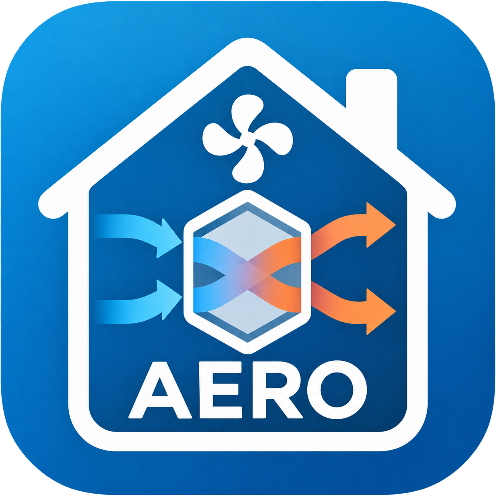
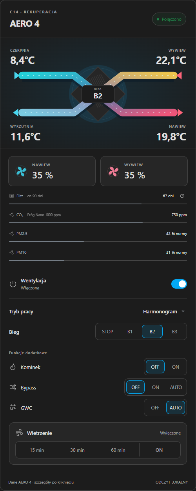
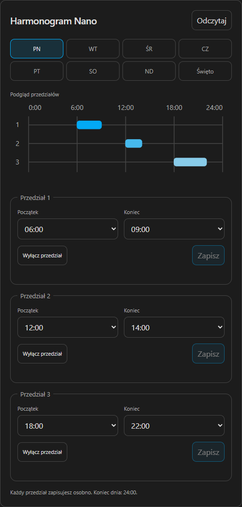

# AERO C14 – Unofficial Home Assistant Integration

<p align="center">
  
</p>

<p align="center">
  <a href="https://github.com/piotremis/aero-c14/releases">
    
  </a>
  <a href="https://github.com/piotremis/aero-c14/blob/main/LICENSE">
    
  </a>
  <a href="https://hacs.xyz">
    
  </a>
  
  
</p>

Lokalna integracja rekuperatora **AERO 4** z panelem **Nano Color 2**. Umożliwia odczyt parametrów, sterowanie wentylacją i zarządzanie harmonogramem bez korzystania z chmury iNext.

**Wersja: 1.0.1** · **Języki: polski i angielski** · **Licencja: MIT**

## Podgląd kart

Dwie karty panelu są dołączone do integracji: sterowanie rekuperatorem oraz edytor harmonogramu Nano. Poniższe widoki przedstawiają przykładowe dane; czujniki jakości powietrza są opcjonalne.

<table>
  <tr>
    <th>Rekuperator</th>
    <th>Harmonogram Nano</th>
  </tr>
  <tr>
    <td align="center" valign="top" width="50%">
      <a href="images/aero-c14-card.png"></a>
    </td>
    <td align="center" valign="top" width="50%">
      <a href="images/aero-c14-schedule-card.png"></a>
    </td>
  </tr>
</table>

Kliknij obraz, aby zobaczyć pełny rozmiar.

## Możliwości

- Temperatury czerpni, nawiewu, wywiewu, wyrzutni i pomieszczenia.
- Wilgotność w pomieszczeniu oraz wydajność wentylatorów.
- Włączanie wentylacji, wybór trybu pracy i biegu.
- Sterowanie bypassem, GWC i pracą z kominkiem.
- Wietrzenie na 15, 30 lub 60 minut oraz praca bez limitu czasu.
- Licznik wymiany filtra z paskiem pozostałego czasu i resetowaniem.
- Edytor tygodniowego harmonogramu Nano, w tym programu świątecznego.
- Rozszerzone nastawy urządzenia i synchronizacja zegara.
- Automatyczne wykrywanie opcjonalnych czujników CO₂, PM2,5 i PM10.
- Dwie dołączone karty panelu Home Assistant.

## Spis treści

- [Podgląd kart](#podgląd-kart)
- [Wymagania](#wymagania)
- [Instalacja](#instalacja)
- [Konfiguracja](#konfiguracja)
- [Karty panelu](#karty-panelu)
- [Encje](#encje)
- [Aktualizacja](#aktualizacja)
- [Diagnostyka i pomoc](#diagnostyka-i-pomoc)
- [Rozwój projektu](#rozwój-projektu)

## Wymagania

| Element | Wymaganie |
| --- | --- |
| Urządzenie | AERO 4 z panelem Nano Color 2 |
| Połączenie | Adapter USB/RS485 lub przezroczysty konwerter TCP/RS485 |
| Magistrala | C14, 9600 bodów, 8N1 |
| Home Assistant | 2026.10.4 lub nowszy, z obsługą integracji niestandardowych |

Integrację rozwijano na AERO 4A.58 i Nano Color 2 z firmware 6.30. Dostępność poszczególnych funkcji zależy od wersji urządzenia i podłączonego wyposażenia.

Konwerter TCP musi przesyłać surowe dane portu szeregowego. Tryby Modbus TCP i RFC2217 nie są obsługiwane. Adapter USB musi być dostępny dla procesu Home Assistant; na Linuxie zalecana jest ścieżka `/dev/serial/by-id/…`.

## Instalacja

### Marketplace

[](https://my.home-assistant.io/redirect/marketplace_repository/?owner=piotremis&repository=aero-c14&category=integration)

1. Otwórz repozytorium przyciskiem powyżej.
2. Dodaj je jako repozytorium niestandardowe kategorii **Integracja**, jeśli pojawi się taka prośba.
3. Wyszukaj **AERO C14** i zainstaluj integrację.
4. Uruchom ponownie Home Assistant.

Adres repozytorium: [piotremis/aero-c14](https://github.com/piotremis/aero-c14).

### Instalacja ręczna

1. Pobierz i rozpakuj archiwum wydania.
2. Skopiuj katalog `custom_components/compit_aero4` do `/config/custom_components/`.
3. Uruchom ponownie Home Assistant.

Do katalogu konfiguracji HA kopiujesz wyłącznie komponent.

## Konfiguracja

Wybierz **Ustawienia → Urządzenia i usługi → Dodaj integrację → AERO C14**.

| Ustawienie | Opis |
| --- | --- |
| Połączenie szeregowe | Port adaptera USB/RS485 |
| Połączenie TCP | Adres i port konwertera TCP/RS485 |
| Próg świeżości | Czas, po którym brak nowych danych oznacza niedostępny odczyt |
| Lokalne odpytywanie | Odczyt nastaw i obsługa sterowania przez integrację |
| Rozszerzone nastawy | Dodatkowe parametry urządzenia i obsługa harmonogramu |
| Synchronizacja zegara | Opcjonalne automatyczne ustawianie czasu Nano z HA |

Domyślnie integracja pracuje jako odbiornik danych. Aby korzystać ze sterowania i edytora harmonogramu, włącz **Lokalne odpytywanie** i **Rozszerzone nastawy**.

Przed włączeniem lokalnego odpytywania odłącz iNext lub inną bramkę sterującą tą samą magistralą. Nano pozostaje masterem. Z jednego portu adaptera może korzystać tylko jeden odbiornik.

### Wykrywanie innych bramek

Wykrywanie innych bramek C14 jest domyślnie włączone, również po aktualizacji istniejącej instalacji. Wykrycie innej bramki blokuje lokalne odpytywanie i sterowanie przez HA.

Jeśli występują fałszywe wykrycia, otwórz **Ustawienia → Urządzenia i usługi → AERO C14 → Rekonfiguruj**, wybierz połączenie Serial lub TCP i zaznacz **Wyłącz wykrywanie innych bramek na magistrali**. Zapisanie konfiguracji przeładuje integrację. Odznaczenie tej opcji ponownie włącza wykrywanie.

Po wyłączeniu wykrywania użytkownik odpowiada za to, aby podczas lokalnego odpytywania przez HA do tej samej magistrali nie podłączać iNext ani innej bramki C14. Timeouty, kontrola poprawności ramek i obsługa przerwanych transmisji nadal działają. Aktualny stan wykrywania jest widoczny w diagnostyce jako `polling.gateway_detection`.

## Karty panelu

Integracja automatycznie rejestruje obie karty jako zasoby Lovelace typu `module`. Nie trzeba dodawać plików JavaScript ręcznie. Rejestracja działa po restarcie Home Assistant i przeładowaniu integracji, usuwa powtórzone wpisy tych kart i aktualizuje adresy zasobów na podstawie zawartości plików, aby unieważnić cache.

Obsługiwany jest również tryb `resource_mode: yaml` w sekcji `lovelace`: karty są dodawane do zasobów w pamięci HA, także po wywołaniu `lovelace.reload_resources`. Pliki YAML użytkownika pozostają bez zmian. Błędy rejestracji są zapisywane w dzienniku integracji.

Karty są dostarczane razem z integracją. W panelu wybierz **Edytuj → Dodaj kartę → Ręcznie** i wklej odpowiednią konfigurację.

### Rekuperator

```yaml
type: custom:aero4-card
title: Rekuperator
```

Karta pokazuje przepływ powietrza, temperatury, wydajność wentylatorów i najważniejsze elementy sterowania. Wybrana opcja lekko pulsuje podczas oczekiwania na potwierdzenie. Pozostałe funkcje pozostają dostępne.

- **Wentylacja** — włączenie i wyłączenie urządzenia.
- **Tryb pracy** — Harmonogram, Ręcznie, Urlop i Poza domem.
- **Bieg** — STOP, B1, B2 i B3; wybór biegu przełącza sterowanie na ręczne.
- **Kominek, bypass i GWC** — wybór odpowiedniego trybu.
- **Wietrzenie** — limit czasu lub ON bez limitu; podczas pracy przycisk OFF kończy wietrzenie.

Pozostały czas wietrzenia jest wyświetlany pod przyciskiem OFF. Odliczanie działa w integracji, również po zamknięciu przeglądarki. Termin jest zachowywany po przeładowaniu integracji i restarcie HA. Gdy HA jest wyłączony lub utraci łączność, zakończenie wietrzenia może nastąpić dopiero po odzyskaniu połączenia.

Pasek filtra pokazuje pozostałe dni do wymiany, również po przekroczeniu terminu. Kolor i pulsowanie wskazują zbliżającą się wymianę. Po wymianie filtra kliknij ikonę resetowania obok liczby dni.

Dostępne czujniki jakości powietrza pojawiają się pod filtrem jako niewielkie wiersze z szarymi paskami. Kliknięcie wartości otwiera szczegóły encji. CO₂ jest podawane w ppm; PM2,5 i PM10 w procentach normy raportowanej przez czujnik. Dla CO₂ pasek odnosi się do progu ustawionego w Nano; bez znanego progu wyświetlana jest sama wartość.

Przy jednym urządzeniu encje są odnajdywane automatycznie. Przy wielu urządzeniach podaj identyfikator z rejestru HA:

```yaml
type: custom:aero4-card
title: Rekuperator
device: identyfikator_urzadzenia
```

### Harmonogram

```yaml
type: custom:aero4-schedule-card
title: Harmonogram
```

Edytor obsługuje dni tygodnia, program świąteczny i trzy przedziały dziennie. Zmiany są wysyłane dopiero po wybraniu **Zapisz**. Operacje zapisu harmonogramu wymagają konta administratora HA.

## Encje

| Typ | Przykłady |
| --- | --- |
| Sensory | Temperatury, wilgotność, wydajność wentylatorów, stan filtra |
| Sensory binarne | Połączenie, stan bypassu, GWC i wietrzenia |
| Przełączniki | Wentylacja, kominek i dodatkowe funkcje urządzenia |
| Listy wyboru | Tryb pracy, bieg, bypass i GWC |
| Nastawy liczbowe | Temperatury zadane, progi, czasy i wydajności biegów |
| Przyciski | Reset filtra i synchronizacja zegara |

Część encji diagnostycznych jest domyślnie wyłączona. Można je włączyć na stronie urządzenia.

Encje CO₂, PM2,5 i PM10 powstają po wykryciu odpowiedniego czujnika na C14. Bez czujnika nie są dodawane. Po utracie aktualnego pomiaru stają się niedostępne. Obsługa tych czujników została sprawdzona testami symulacyjnymi; wymaga jeszcze potwierdzenia na fizycznym wyposażeniu.

## Aktualizacja

1. Zainstaluj aktualizację w Marketplace lub zastąp katalog komponentu przy instalacji ręcznej.
2. Uruchom ponownie Home Assistant.
3. Odśwież panel przez **Ctrl+F5**, aby załadować aktualny kod kart.

Istniejący wpis integracji i nastawy pozostają zachowane.

## Diagnostyka i pomoc

Na stronie integracji wybierz **Pobierz diagnostykę**. Przy zgłaszaniu problemu podaj wersję Home Assistant i integracji, model urządzenia, sposób połączenia oraz kroki odtworzenia błędu.

Problemy i propozycje zmian zgłaszaj w [GitHub Issues](https://github.com/piotremis/aero-c14/issues). Przed dołączeniem logów sprawdź, czy nie zawierają danych dostępowych lub prywatnej konfiguracji.

## Rozwój projektu

Zasady zgłaszania błędów i proponowania zmian znajdują się w [CONTRIBUTING.md](CONTRIBUTING.md). Publiczne repozytorium zawiera kod integracji i dokumentację użytkową. Testy, dane transmisji i materiały badawcze są utrzymywane poza nim.

## Specjalne podziękowania dla:

**Piotr Murawski** za pomoc w opisaniu protokołu C14 i konsultacje podczas testowania integracji.

## Źródła i licencja

Dziękujemy autorom [ha-c14](https://github.com/Pioszym/ha-c14), [esphome-awenta-auros](https://github.com/d-lebed/esphome-awenta-auros) i [ha-compit-c14](https://github.com/mnowak3/ha-compit-c14) za udostępnienie informacji o protokole C14.

Kod integracji powstał przy wsparciu Codex firmy OpenAI, wykorzystywanego do implementacji, analizy komunikacji C14, tworzenia testów automatycznych i przygotowania kart Home Assistant. Dziękujemy OpenAI za udostępnienie tego narzędzia.

Wskazane projekty wykorzystano jako źródła publicznie dostępnych informacji o działaniu protokołu C14 i mapowaniu parametrów. Implementacja tej integracji jest niezależna; nie zawiera kodu źródłowego ani firmware tych projektów.

| Repozytorium | Licencja materiałów źródłowych |
| --- | --- |
| [Pioszym/ha-c14](https://github.com/Pioszym/ha-c14) | [MIT — kod](https://github.com/Pioszym/ha-c14/blob/main/LICENSE); [CC BY-SA 4.0 — dokumentacja](https://github.com/Pioszym/ha-c14#licencje) |
| [d-lebed/esphome-awenta-auros](https://github.com/d-lebed/esphome-awenta-auros) | [Apache 2.0](https://github.com/d-lebed/esphome-awenta-auros/blob/main/LICENSE) |
| [mnowak3/ha-compit-c14](https://github.com/mnowak3/ha-compit-c14) | [MIT](https://github.com/mnowak3/ha-compit-c14/blob/main/LICENSE) |

Kod tej integracji jest udostępniany na [licencji MIT](LICENSE).

## Nota prawna i wyłączenie odpowiedzialności

Jest to niezależna, nieoficjalna integracja dla Home Assistant, rozwijana społecznościowo. Projekt nie jest powiązany z firmą COMPIT, nie jest przez nią autoryzowany, sponsorowany ani wspierany.

Implementacja protokołu komunikacyjnego C14 opiera się na niezależnej obserwacji i analizie komunikacji pomiędzy legalnie nabytymi urządzeniami oraz na publicznie dostępnych informacjach, w celu zapewnienia interoperacyjności.

Projekt nie zawiera zastrzeżonego firmware ani kodu źródłowego firmy COMPIT.

COMPIT, AERO, Nano Color oraz iNext są nazwami produktów lub znakami towarowymi ich właścicieli. Są używane wyłącznie w celu identyfikacji kompatybilnego sprzętu.

Oprogramowanie jest udostępniane na licencji MIT, bez jakichkolwiek gwarancji. Jest przeznaczone wyłącznie do używania z urządzeniami, które użytkownik posiada lub do których obsługi jest uprawniony.

Zmiana ustawień urządzenia, w szczególności zaawansowanych parametrów serwisowych, może wpływać na jego działanie, bezpieczeństwo i warunki gwarancji. Użytkownik odpowiada za zapewnienie zgodności konfiguracji z zaleceniami producenta.

Korzystanie z oprogramowania odbywa się na własne ryzyko użytkownika, w zakresie dozwolonym przez obowiązujące prawo.
